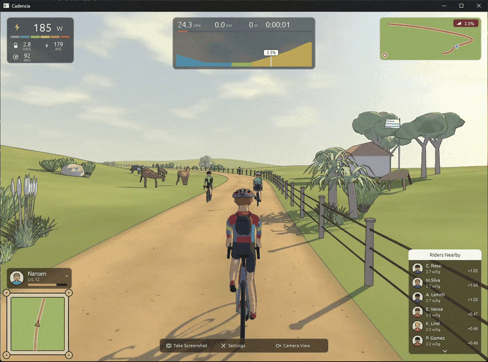

# Cadencia

**Indoor cycling, drawn by hand — rendered in real time.**

Cadencia is a cross-platform indoor cycling training app that turns your smart trainer into a ticket through three stylized worlds. Every frame is rendered live in Rust + WebGPU, in a hand-drawn comic-book style.



## The Worlds

| World | Setting | Loop | Max Grade | Surface |
| :--- | :--- | :--- | :--- | :--- |
| **Cerro** | High Alpine Ridge & Canyon Pass | 1.8 km | +6.9% | Alpine Tarmac |
| **Rambla** | Sunset Bay Seawall & Colonial Coast | 2.2 km | +2.4% | Coastal Pave |
| **Campo** | Olive Hills & Countryside Gravel Loop | 1.6 km | +4.5% | Compact Gravel |

Each world is a closed Catmull-Rom route with real elevation — climb the pass, descend into the canyon, and feel the gradient change under your watts.

## Features

- **Real trainer integration over Bluetooth LE** — FTMS indoor-bike control (ERG & SIM), plus power/cadence speed (CPS), speed/cadence (CSC) and heart-rate (HRS) sensors. No trainer? A built-in simulator keeps the cranks turning.
- **Faithful cycling physics** — gravity, rolling resistance, aerodynamic drag, peloton drafting, virtual gearing and cornering lean.
- **A living peloton** — AI riders and skinned animals share the road with you.
- **HUD built for the ride** — power card with 6-zone bar, W/kg, ride timer, and a live route-corridor minimap with grade badge.
- **English & Spanish UI**, auto-detected from your system language.
- **Seven camera modes**, from chase cam to first person.

## Under the Hood

- **Rust** — `wgpu` 30 + WGSL, `winit`, `egui`, `btleplug`. No game engine.
- **Deferred hand-drawn comic pipeline** — unlit domain-specific G-Buffer passes, 3-cascade directional shadow maps, screen-space outlines, and an 8-phase Halton TAA with contrast-adaptive sharpening and paper grain.
- **Aggressive culling** — a CPU 3D octree feeds four GPU indirect-draw culling dispatches; static props are pre-baked per sector into CSM size-tiered meshes.
- **Tight memory budget** — every mesh vertex is exactly 24 bytes.

## Platforms

| Platform | Status |
| :--- | :--- |
| Windows / Linux (desktop) | `cargo run` |
| Web (WASM + WebGPU/WebGL) | `trunk serve` |
| Android (arm64, NativeActivity) | `build_android_apk.ps1` |

## Getting Started

```powershell
# Desktop (WebGPU)
cargo run --offline

# Jump straight into a world: cerro, rambla or campo
cargo run --offline -- --level rambla

# Headless screenshots (great for CI)
cargo run --offline -- --screenshot screenshots/mountain.png --biome mountain

# Web build
trunk serve

# Android APK (requires the Android SDK/NDK; produces cadencia.apk)
powershell -ExecutionPolicy Bypass -File .\build_android_apk.ps1
```

Useful flags: `--screen <main_menu|world_select|settings|gear|ingame>`, `--camera <chase|close|wide|side|fp|...>`, `--width <px>`, `--height <px>`.

## License

Released under the MIT License.
